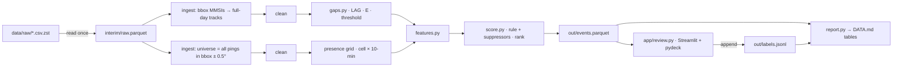

# PLAN v2.1 — Dark-ship gap detection on one day of US AIS (RSKD Labs take-home)

Version 2.1 · 2026-11-08 · Status: **for approval.** No code is written yet.
Deadline: Mon 2026-11-09 12:00 IST (target: submit by 10:00 IST).

## Changes from v1

| # | Review item | Change |
|---|---|---|
| 1 | 1. Coverage | Removed `neighbour_dropout` and `n_neighbours`. They broke on long gaps, because neighbours leave the dead zone and are heard elsewhere. |
| 2 | 1. Coverage | Added a **presence grid**: (0.1° cell, 10-min bucket) → `n_pings`, `n_mmsi`, `min_mmsi`. It is built from **all** vessels in the bbox plus a 0.5° margin. |
| 3 | 1. Coverage | Added `coverage_during_gap`: the share of the gap's 10-min buckets in which another vessel was heard in the 3×3 cells around p0 or p1. It is computed in one DuckDB query. |
| 4 | 1. Coverage | Self-exclusion uses the per-cell distinct count. A cell holds another vessel when `n_mmsi ≥ 2 OR min_mmsi ≠ this mmsi`. |
| 5 | 1. Coverage | Set `C = coverage_during_gap`. The outage suppressor became a coverage-hole suppressor (`< 0.2 → ×0.2`, in config). The edge-of-coverage suppressor is gone. *Superseded by row 29.* |
| 6 | 1. Coverage | Removed `coverage_edge` (both parts). `cell_density0/1` is now a display-only diagnostic. |
| 7 | 1. Coverage | Recomputed the worked example: **83.1**, counterfactual **12.2** (*now 72.8 / 11.6, see row 29*). Updated §5, §6, §7 diagram, §8 schema, §9 map layer and §10 tests. |
| 8 | 1. Coverage (my addition) | Added a display-only diagnostic, `max_excursion_nm`. The endpoint test cannot see a ship that sails out of range and back (see the known limitation in §6). |
| 9 | 2. Cuts | Removed the Isolation Forest and the weight-perturbation study. The leave-one-term-out ablation stays. |
| 10 | 2. Cuts | Removed the port list and `dist_port_nm`. The port suppressor is now `stationary_cell` OR (status 1/5 at both ends AND dist < 0.5 nm) OR (sog0 < 0.5 AND sog1 < 0.5). |
| 11 | 2. Cuts | Shortened the cut list. |
| 12 | 3. K | `K = unaccounted_frac`. `dcog_deg` is display-only. |
| 13 | 4. Build order | §11 is now a dated IST steel-thread schedule with a "done when" line for each block. |
| 14 | 4. Build order | `run.py` converts the raw `.zst` to Parquet once and skips that on rerun unless `--force`. |
| 15 | 5. Fog | Added a spring-fog risk and a day-switch rule that applies in block 1 only. The decision is recorded in DATA.md. |
| 16 | 6. README | Added the "never returns / appears mid-box" limitation and a matching item to the "with a week" list. |
| 17 | 7. Hygiene | Removed the skill meta-commentary. Kept the format findings as "Data format notes". |
| 18 | 7. Hygiene | Added a frontier-search row to the README tool log. |
| 19 | 7. Hygiene | Pinned requirements. Added a commit after each block. |
| 20 | 8. Tests | Kept 2 test files and 7 cases, including a synthetic coverage-hole case. `test_clean.py` is dropped; one MMSI-filter assertion moved into `test_gaps.py`. |
| 21 | RSKD Q1–Q4 | §12 now records RSKD's answers. |
| 22 | RSKD Q3 | **Label semantics changed**: `real` now means presumed intentional, with coverage shown and no innocent cause. Updated §8, §9, README. |
| 23 | RSKD Q2 | Confirms the v1 track-selection design. No change. |
| 24 | RSKD Q4 | `.gitignore` excludes `data/raw/` and `data/interim/`. `out/*.parquet` and `out/*.jsonl` are committed. |

### v2 → v2.1 (response to flagged points)

| # | Point | Change |
|---|---|---|
| 25 | 1. max_excursion | Now defined exactly as the semi-minor axis of the reachable ellipse: `L = typical_kn·gap_h`, `max_excursion_nm = 0.5·sqrt(max(L² − dist_nm², 0))`. Null if `typical_kn` is null. Display-only, shown on the review card. |
| 26 | 2. Raw file | Confirmed the raw file is never committed. The README states the download command and the 227.7 MB size. `report.py` prints the size of each output and warns above 50 MB. |
| 27 | 3. Empty water | Added `heard_today`: was another vessel heard in the 3×3 cells around p0 or p1 at any time that day? C becomes three-way. The coverage-hole suppressor fires only when nothing was heard during the gap and nothing nearby all day (or when coverage is between 0 and 0.2). |
| 28 | 3. Empty water | DATA.md notes that a receiver outage during a gap reads as "quiet", and that the hourly bbox count is the check for it. `heard_today` added to the schema, the review card and test case 5. The worked example is unchanged. |
| 29 | 3. Empty water (follow-up) | **C = max(coverage_during_gap, 0.5 if heard_today else 0).** The suppressor fires only when NOT `heard_today`, so the 0.2 threshold is gone. This fixes an inversion where weak coverage during the gap (scored about 12) ranked below no coverage during the gap (about 73). Counterfactuals are now 72.8 and 11.6, and test case 5 gains a monotonicity check. |
| 30 | 4. Pins | Removed the pinned versions. Block 1 builds a fresh `.venv` and runs a smoke test. Block 2 runs pytest, then `pip freeze > requirements.txt`. If anything fails, fall back to the previous major's last stable minor. `.venv/` is gitignored. |

---

## 1. Requirements traceability

| Brief requirement | Where |
|---|---|
| One day of MarineCadastre AIS; one coastal bbox; only vessels seen there; day and bbox stated in README | §2, §3, §13 |
| Load (DuckDB) and clean | §3, §7 |
| Every gap, for every vessel | §4 |
| Per gap: duration, position/speed/heading before and after, distance, implied speed | §5 (required rows) |
| Own features separating real from innocent | §5 (extras) |
| Top 50 by a documented, defensible rule | §6 |
| Review page: one event at a time, map of track before/after, real / data artefact / unsure + note | §9 |
| Review all 50 myself | §11, protected block |
| `labels.jsonl` and `events.parquet`, documented as a training set | §8 |
| `DATA.md` (source, date, bbox, stage counts, features, label counts) | §8 |
| README with 5 sections, including an AI-tool log | §13 |
| Git repo and a one-line end-to-end command | §7 |
| "Expect that much of what looks suspicious is not" | §3, §6 suppressors, §10 |
| "Finished and small beats ambitious and broken" | §11 steel thread and cut list |
| Live code changes in the follow-up call | §7: one config file, small modules, plain SQL |

---

## 2. Data selection (unchanged)

| | Choice | Why |
|---|---|---|
| **Day** | **Wed 2026-04-15 (UTC)**. File `ais-2026-04-15.csv.zst`, 227,742,913 bytes. | A recent mid-week working day with no holiday. Its size is in line with its neighbours (Apr 14: 223 MB, Apr 16: 236 MB), so there is no sign of a feed outage. It is not 2026-06-04 (138 MB, an outlier). |
| **BBox** | **lat 28.40 → 29.90, lon −95.60 → −93.70** (Houston–Galveston approaches) | Dense tanker, cargo, tug and offshore-supply traffic, plus shrimp fishing and Class B leisure boats. The offshore edge is about 50 nm out, near NOAA's stated coverage limit, so the coverage test has work to do. |
| **Presence universe** | bbox ± 0.5° → **lat 27.90 → 30.40, lon −96.10 → −93.20** | 3×3 cell neighbourhoods at the box edge need data outside the box. |

| Alternative (if the block-1 check fails) | Day | BBox |
|---|---|---|
| A1: LA/Long Beach | Tue 2026-03-17 (215 MB) | lat 33.30–34.10, lon −118.90 to −117.80 |
| A2: Florida Strait | Wed 2026-05-20 (274 MB) | lat 24.00–26.00, lon −82.00 to −79.50 |

**Download** (Windows PowerShell; also saved as `scripts/download.ps1`):
```powershell
curl.exe -L --create-dirs -o data\raw\ais-2026-04-15.csv.zst https://noaaocm.blob.core.windows.net/ais/csv2/csv2026/ais-2026-04-15.csv.zst
```
- Size is 227.7 MB compressed; about 1.5–2.5 GB uncompressed (estimate).
- Rows: about 8–15 M nationally and 0.3–1 M in the bbox (estimates). Block 1 replaces both with the real `COUNT(*)`.

### Data format notes
- Daily files are named `ais-YYYY-MM-DD.csv.zst` under `https://noaaocm.blob.core.windows.net/ais/csv2/csv{YYYY}/`. Data runs through 2026-06-30.
- **The brief's "~500 MB CSV" describes the pre-2025 format.** Since 2025 the files are zstd-compressed, about 190–320 MB per day.
- 2025+ schema (snake_case; **longitude comes before latitude**): `mmsi, base_date_time, longitude, latitude, sog, cog, heading, vessel_name, imo, call_sign, vessel_type, status, length, width, draft, cargo, transceiver`.
- Sentinel values (SOG 102.3, heading 511, COG 360, lat 91 / lon 181) are **already null** in 2025+ files. They are still filtered defensively.
- NOAA **downsamples to one position per minute**. Receivers are terrestrial only, with no satellite AIS. Coverage stops about 40–50 miles from the coast. Times are UTC. Class B is included.
- USCG reporting rates: Class A every 2–10 s underway and every ≤3 min at anchor or moored. Class B reports less often. AtoN MMSIs are `993…`, base stations `00MID…`, SART devices `970/972/974…`.
- The Class B "30 s above 2 kn" figure comes from ITU-R M.1371 and could not be confirmed on the USCG page. The rule below is conservative either way.

---

## 3. AIS pitfalls and handling

H = handled in cleaning · F = feature or flag · N = not handled, deliberately

| Pitfall | | How / why |
|---|---|---|
| Sentinels (102.3 / 511 / 360 / 91 / 181) | H | SQL sets them to NULL, or drops the row for bad lat/lon. Cheap insurance against format drift. |
| Invalid or shared MMSI (not 9 digits, 0, 123456789, base station, AtoN, SART, SAR aircraft) | H | Keep `mmsi BETWEEN 201000000 AND 775999999` and drop a small denylist. Applied to **both** the tracks and the presence universe. |
| One MMSI in two places at once | F | `jump_rate` is the share of consecutive non-gap pairs with implied speed above 50 kn. Above 5%, the vessel gets `mmsi_conflict`, which triggers the ×0.1 suppressor. |
| Exact duplicates | H | `DISTINCT`; the count is logged. |
| Same mmsi + timestamp, different position | H + F | Keep the first row and count the rest, which feeds `jump_rate`. |
| Out-of-order timestamps | H | `ORDER BY mmsi, base_date_time` before `LAG`. Unit-tested. |
| Class A vs B rates; anchored or moored vessels report slowly | H | The gap threshold depends on class and state (§4). |
| 1-minute downsampling | H | Expected interval = max(60 s, nominal). |
| Terrestrial coverage holes and receiver outages | F | `coverage_during_gap` (§5): was anyone else heard where this ship was, while it was silent? `heard_today` separates "quiet water inside coverage" from "never covered". `C = max(coverage_during_gap, 0.5·heard_today)`, and the hole suppressor fires only when NOT `heard_today`. |
| Whole-feed outage or fog day | F | Hourly bbox message count in block 1, with a switch-day rule (§12). |
| BBox edge effects | H | A vessel is selected if it has ≥1 ping inside the bbox, and its **full national-day track** is used. Events are kept only if ≥1 endpoint is inside the bbox. RSKD confirmed this. |
| Day boundary | H | Gaps exist only between two pings on the same day. A vessel going dark at 22:00 and not returning is **N** (see the README limitation). |
| Port, berth or anchorage stops | F | `stationary_cell`, status 1/5, or near-zero SOG at both ends. Handled by the port suppressor. |
| Stale nav status | N | Speed is trusted over status when they disagree. |
| GPS errors such as positions on land | N | Rare; they surface as `teleport`. No coastline dependency. |
| Status missing for Class B | H | Null status means "unknown", never "underway". |

---

## 4. Gap definition (unchanged)

The expected interval `E` uses the state at the ping **before** the gap.

| Class | State | Nominal rate | `E` here |
|---|---|---|---|
| A | underway (SOG ≥ 0.5, status ∉ {1,5}) | 2–10 s | 60 s |
| A | anchored or moored, or SOG < 0.5 | ≤ 3 min | 180 s |
| B or unknown | SOG > 2 kn | 30 s | 60 s |
| B or unknown | SOG ≤ 2 kn or null | 3 min | 180 s |

**Gap rule:** `dt ≥ max(GAP_MIN_S = 600, K × E)` with **K = 10**, giving 10 min underway and 30 min slow or anchored. Both values live in config.

Why: an underway Class A vessel sends 60+ reports in 10 minutes. Losing all of them at random is implausible, so the cause must be systematic (coverage, an outage, or the transponder being off).

DATA.md reports gap counts at **K = 5 / 10 / 20**. `gap_ratio = dt / E` is kept as a feature.

---

## 5. Feature set (p0/t0 = last ping before the gap; p1/t1 = first ping after)

| Feature | Formula | Units | Use | Hypothesis |
|---|---|---|---|---|
| `gap_s`, `gap_ratio` | t1−t0; gap_s/E | s; – | scored (D) | Longer relative silence → more suspicious |
| `lat0, lon0, lat1, lon1` | positions | deg | required | |
| `sog0, sog1, cog0, cog1, hdg0, hdg1` | values at each end | kn, deg | required | |
| `dist_nm` | haversine(p0, p1) | nm | required | |
| `implied_kn` | dist_nm / (gap_s/3600) | kn | required | |
| `typical_kn` | the vessel's median SOG over pings with SOG > 1 that day | kn | display | The vessel's own baseline |
| `speed_ratio` | implied_kn / typical_kn | – | display | ≪1 stopped or loitered while dark; ≫1 impossible |
| `unaccounted_frac` | clip(1 − (dist_nm / mean(sog0,sog1)) / gap_h, 0, 1) | – | scored (K) | Time not explained by a straight transit |
| **`coverage_during_gap`** | see the definition below | 0–1 | **scored (C) + suppressor** | Others were heard here while this ship was silent → the area was reachable |
| **`heard_today`** | another vessel was heard in the 3×3 cells around p0 or p1 at **any** time that day | bool | **C fallback + suppressor** | Quiet water inside coverage vs. water that is never covered |
| `max_excursion_nm` | L = typical_kn · (gap_s/3600); 0.5 · sqrt(max(L² − dist_nm², 0)); null if typical_kn is null | nm | display | Semi-minor axis of the ellipse the ship could reach with foci p0 and p1: how far off the straight line it *could* have gone (out of range and back) |
| `stationary_cell` | either end in a 0.05° cell whose median SOG is below 0.5 kn | bool | suppressor | Berth or anchorage |
| `teleport` | implied_kn > 50 and type not 40–49 | bool | suppressor | Data error |
| `mmsi_conflict`, `jump_rate` | §3 | bool, – | suppressor | Shared or spoofed MMSI |
| `dcog_deg` | smallest angle between cog0 and cog1 | deg | display | The channel bends, so this is noise for scoring |
| `cell_density0/1` | distinct MMSIs in the 0.1° cell over the whole day | count | display | Traffic context for the reviewer |
| `p0_in_bbox`, `p1_in_bbox`, `bbox_edge_nm`, `near_day_boundary` | | bool, nm | display | Edge and boundary diagnostics |
| `vessel_group`, `transceiver`, `status0/1`, `length` | static fields | – | scored (T) / display | Commercial Class A has a carriage obligation |
| `n_gaps_vessel` | gaps per MMSI | count | display | A chronically flaky unit points to an innocent cause |

### `coverage_during_gap`: definition and SQL shape
1. **Universe:** all cleaned pings from **all** vessels inside bbox ± 0.5°.
2. **Presence grid:** `GROUP BY cx = floor(lon/0.1), cy = floor(lat/0.1), b = time_bucket(10 min)`, keeping `n_pings`, `n_mmsi = count(DISTINCT mmsi)` and `min_mmsi = min(mmsi)`.
3. **Buckets for each gap:** every bucket `b` with `b < t1 AND b + 10 min > t0`, generated with `generate_series` in SQL.
4. **Neighbourhood:** join the grid on `|cx − cx0| ≤ 1 AND |cy − cy0| ≤ 1`, or the same around p1.
5. **Exclude this ship:** a cell holds another vessel when `n_mmsi ≥ 2 OR min_mmsi <> gap.mmsi`.
   - Why this method: it is exact (a cell with one vessel that isn't X, or with two or more vessels, must hold someone other than X), and it keeps the grid at one row per cell-bucket with no anti-join.
6. **Result:** `coverage_during_gap = (buckets where any neighbourhood cell has another vessel) / (buckets overlapping the gap)`.
7. **`heard_today`:** the same neighbourhood join with the same exclusion rule, but over **all** of the day's buckets instead of only those overlapping the gap. It is a `bool_or` in the same query.

This is one SQL statement with no Python loops.

---

## 6. Scoring rule

**Score (0–100) = 100 × (0.35·D + 0.30·C + 0.15·U + 0.10·K + 0.10·T) × Π suppressors**

The weights and all thresholds live in `config.toml`.

| Term | Definition | One-line rationale |
|---|---|---|
| D | clip(log10(gap_ratio)/3, 0, 1) | Log scale: going from 10 min to 1 h matters more than from 10 h to 11 h. |
| C | `max(coverage_during_gap, 0.5 if heard_today else 0)` | Others were heard where this ship was, so the area was reachable (RSKD's definition of "real"). In-range water gets at least a neutral 0.5, and C never falls when the evidence of coverage rises. |
| U | 1 if sog0 ≥ 2 and status0 ∉ {1,5}, otherwise 0 | Going silent while moving is the core signal. |
| K | `unaccounted_frac` | Time the ship can't account for with a straight transit. |
| T | 1 for Class A tanker, cargo or fishing; 0.6 for other Class A; 0.3 for Class B or unknown | Only Class A commercial vessels are required to transmit. |

| Suppressor | Trigger | Factor |
|---|---|---|
| Coverage hole | NOT `heard_today`: no other vessel was heard near p0 or p1 at any time that day, so `coverage_during_gap` is necessarily 0 | ×0.2 (factor in config) |
| Port, berth or anchorage | `stationary_cell` OR (status ∈ {1,5} at both ends AND dist_nm < 0.5) OR (sog0 < 0.5 AND sog1 < 0.5) | ×0.2 |
| Teleport | `teleport` | ×0.3 |
| Shared or spoofed MMSI | `mmsi_conflict` | ×0.1 |

### Worked example (hypothetical numbers)
A Class A tanker with sog0 = sog1 = 11.5 kn and status 0. Gap of 3 h (from 03:12 to 06:12), dist = 12 nm, so implied speed = 4.0 kn. The gap overlaps 19 ten-minute buckets; another vessel was heard near p0 or p1 in 16 of them. Not stationary.

- D = log10(10800/60)/3 = log10(180)/3 = **0.752**
- C = 16/19 = **0.842**
- U = **1**
- K = 1 − (12/11.5)/3 = **0.652**
- T = **1**
- Raw = 0.263 + 0.253 + 0.150 + 0.065 + 0.100 = 0.831 → **83.1**, with no suppressors.

**Counterfactual 1 (quiet but in range):** the same gap, but others were heard in only 2 of 19 buckets. coverage_during_gap = 0.105, `heard_today` = True, so C = max(0.105, 0.5) = **0.5** and no suppressor applies. Raw = 0.263 + 0.150 + 0.150 + 0.065 + 0.100 = 0.728 → **72.8**.

**Counterfactual 2 (never covered):** no other vessel was heard near p0 or p1 all day. C = **0** and the coverage-hole suppressor applies. Raw = 0.263 + 0 + 0.150 + 0.065 + 0.100 = 0.578 → × 0.2 → **11.6**.

The ordering is now 83.1 ≥ 72.8 ≥ 11.6, the same order as the evidence of coverage.

### Weight checks (before review)
1. **Leave-one-term-out ablation:** remove each term, re-rank, and report the top-50 overlap. A term that changes nothing is dead weight; one that changes everything dominates.
2. **Eyeball:** check the top 10 and 10 random events from ranks 51–200 on the map, to look for bugs only.
3. **Freeze the weights before review.** Afterwards, report precision@10/25/50. No re-tuning on the same labels.

**Known limitation:** C looks only at the endpoints. A ship that sails out of range and back will still score as covered. `max_excursion_nm` is shown in the app so I can catch this case by eye.

---

## 7. Architecture



| Stage | Tool | Reason |
|---|---|---|
| Raw → Parquet, filter | DuckDB | Streams the 2 GB `.zst` without loading it into RAM, and the brief names it. |
| Clean, gaps, presence grid, coverage join | DuckDB SQL | Window functions and joins are each one readable query. |
| Remaining features, score | pandas | Small data, and easy to change live. |
| Intermediate files | Parquet in `data/interim/` | Read the raw file once; reruns take seconds. |
| UI | Streamlit + `st.pydeck_chart` | Built in, needs no API key, and PathLayer draws tracks. |
| Config | `config.toml` read with `tomllib` | One file, no extra dependency. |

**Caching:** `run.py` writes `data/interim/raw.parquet` once and reuses it on rerun. `--force` rebuilds it.

```
dark-ships/
├── config.toml          # bbox, margin, date, file, K, GAP_MIN_S, weights, suppressor thresholds
├── run.py               # ingest→clean→gaps→features→score→report; --force rebuilds interim
├── darkships/  geo.py  ingest.py  clean.py  gaps.py  features.py  score.py  report.py
├── app/review.py
├── tests/test_geo.py  tests/test_gaps.py
├── scripts/download.ps1
├── data/raw/  data/interim/  .venv/  # gitignored, kept locally (raw file is never committed)
├── out/events.parquet  out/labels.jsonl   # committed (expected well under 100 MB, see §8)
├── DATA.md  README.md  PLAN.md  requirements.txt  .gitignore
```

**Environment and pins (no versions guessed in advance):**
1. Block 1: create a fresh venv and install the six packages unpinned, then smoke-test that DuckDB can read the `.zst` header:
   ```powershell
   python -m venv .venv; .venv\Scripts\Activate.ps1
   pip install duckdb pandas pyarrow streamlit pydeck pytest
   ```
2. End of block 2, once `pytest` passes: `pip freeze > requirements.txt`. That pins exactly what was tested, including transitive dependencies.
3. If any package fails to install, import or pass the tests, **fall back to the last stable minor of the previous major** (for example `duckdb<2`) rather than debugging a new release.

`.venv/` is gitignored.

**Run:** `python run.py --config config.toml` · **Review:** `streamlit run app/review.py`

**Git:** commit at the end of every block in §11 with a descriptive message, for example `gaps: expected-interval threshold + tests`.

---

## 8. Output schemas

**`events.parquet`:** one row per gap (all gaps).

| Column | Type | Column | Type |
|---|---|---|---|
| event_id (`{mmsi}_{t0:%Y%m%dT%H%M%S}`, PK) | string | gap_s, gap_ratio, expected_interval_s | int32, float32, int16 |
| mmsi | int32 | t0, t1 | timestamp (UTC) |
| vessel_name, imo, call_sign | string | lat0, lon0, lat1, lon1 | float64 |
| vessel_type, vessel_group, transceiver, length | int16, string, string, int16 | sog0, sog1, cog0, cog1, hdg0, hdg1 | float32 |
| status0, status1 | int8 (nullable) | dist_nm, implied_kn, typical_kn, speed_ratio, unaccounted_frac, dcog_deg, max_excursion_nm | float32 |
| coverage_during_gap, n_buckets, n_buckets_covered, heard_today | float32, int16, int16, bool | cell_density0, cell_density1, n_gaps_vessel, jump_rate | int32, int32, int16, float32 |
| teleport, mmsi_conflict, stationary_cell, near_day_boundary, p0_in_bbox, p1_in_bbox | bool | bbox_edge_nm | float32 |
| D, C, U, K, T, suppress_factor, score, rank | float32, int32 | config_hash, pipeline_version | string |

**File sizes (GitHub limit 100 MB per file):**
- `events.parquet` is expected to hold a few thousand to tens of thousands of rows × about 60 columns, so roughly **under 10 MB** (an estimate).
- `labels.jsonl` is 50 lines, about **15 KB**.
- `report.py` prints both sizes and **warns if either is above 50 MB**. If that happens, I will flag it before pushing.

**`labels.jsonl`** (the last line per event_id wins; values below are placeholders):
```json
{"event_id":"367000000_20260415T031200","mmsi":367000000,"rank":7,"score":83.1,"label":"unsure","note":"<one line>","reviewer":"vasanth","labelled_at":"2026-11-08T16:22:31+05:30","config_hash":"a1b2c3d4","pipeline_version":"0.1.0"}
```

**Label semantics (per RSKD):**
- `real`: the ship went dark and nothing explains it except an intentional switch-off. The area was reachable (other vessels were heard there during the gap), and there was no port or anchor stop, no data error and no MMSI clash. This is a **presumption of intent, not proof.**
- `data_artefact`: an innocent cause is visible (coverage hole, outage, slow reporting while parked, teleport or GPS error, shared MMSI).
- `unsure`: the evidence does not decide it, for example an out-and-back excursion that may have left coverage.

**Training-set notes (in DATA.md):**
- **Keys:** `event_id` joins the two files; `config_hash` pins the thresholds.
- **Biases:**
  - Labels cover only the rule's top 50 (selection bias, so they say nothing about recall).
  - One annotator.
  - Terrestrial-only coverage.
  - One day and one region.
  - Labels were made while seeing the rule's features.
  - **Coverage can only be shown where other traffic exists.** Gaps in water heard at some time that day get at least a neutral C = 0.5 (`C = max(coverage_during_gap, 0.5·heard_today)`). Only water with no other vessel nearby all day is suppressed as uncovered.
  - **A receiver outage during the gap reads as "quiet", not "uncovered"**, so it gets C = 0.5 instead of being suppressed. The hourly bbox message count (block 1) is the check for that; any outage hours are listed in DATA.md.
  - UTC day boundary.

**`DATA.md` outline:**
1. Source (URL, file, size)
2. Date, bbox, presence margin, time zone; the block-1 day-check decision
3. Row counts per stage: raw → valid MMSI → valid position → dedup → bbox vessels → their tracks → universe pings → grid cells → gaps (K = 5/10/20) → top 50
4. Hourly bbox message count, with outage hours listed. This is the check for "receiver outage reads as quiet".
5. Feature dictionary
6. Scoring rule
7. Label counts and false-alarm categories
8. Training-set notes
9. Known issues

---

## 9. Review app design

- **Layout:** a sidebar with rank, score, label status and "next unlabelled". Main area: the map, then a feature card, vessel metadata, three label buttons, a one-line note box, and Save & next.
- **Map (`st.pydeck_chart`):**
  - PathLayer: track before the gap (blue) and after it (orange)
  - LineLayer: the p0 → p1 segment (red)
  - ScatterplotLayer: p0 and p1
  - ScatterplotLayer: **other vessels' pings in the 3×3 cells around p0/p1 during [t0, t1]**, faint grey, so I can see coverage directly
  - the bbox outline
  - The view is centred on the gap.
  - Reason over folium: it is built in, needs no extra package, and handles thousands of points.
- **Context shown:**
  - gap time (UTC and IST), gap_s, gap_ratio, E
  - sog/cog/hdg at both ends, dist_nm, implied vs typical speed, unaccounted_frac
  - **coverage_during_gap (k of n buckets)**, **heard_today**, **max_excursion_nm** (null if no typical speed), dcog_deg, cell_density
  - class, type, status, length, n_gaps_vessel
  - the D/C/U/K/T breakdown and which suppressors fired
- **Persistence (unchanged):** append one JSON line per Save, then flush. On start-up, read the file, keep the last record per event_id, and resume at the first unlabelled event in rank order.

---

## 10. Validation and tests

| Test | Cases |
|---|---|
| `tests/test_geo.py` | (0,0)→(0,1) = 111.195 km ± 0.01 · identical points = 0 |
| `tests/test_gaps.py` | (1) shuffled input gives the same gaps · (2) duplicated rows give the same gaps · (3) an anchored vessel at 20-min spacing gives 0 gaps · (4) a track ending at 23:00 gives no trailing gap · (5) **coverage hole**: vessel X has a 60-min gap at P. Vessel Y pings every minute next to P during the gap → coverage = 1.0. Y pings next to P only at 01:00, outside the gap → coverage = 0, `heard_today` = True, C = 0.5, no suppressor. Y heard during 1 of 6 buckets → C = max(0.17, 0.5) = 0.5, no suppressor (monotonic check). Y removed entirely → coverage = 0, `heard_today` = False, suppressor fires. Only X's own endpoint pings in the cells → coverage = 0 and `heard_today` = False (self-exclusion). · (6) a 993xxxxxx MMSI is dropped by clean, so it produces no gaps |

| Pipeline check | How |
|---|---|
| Row-count reconciliation | Each stage count is ≤ the previous one, every drop has a reason, and the counts are printed by `run.py` and written to DATA.md |
| Known-good vessels | The Galveston–Bolivar ferry and pilot boats should have about 0 gaps and coverage near 1 |
| Invariants | `dt > 0`; `implied_kn` finite; ≥1 bbox ping per event MMSI; unique `event_id`; `0 ≤ coverage ≤ 1` |
| Distribution sanity | Histograms of gap_s, coverage_during_gap and implied_kn; 5 random mid-ranked events checked on the map |

---

## 11. Build schedule (IST, steel thread first)

| When (IST) | Block | Done when |
|---|---|---|
| Sun 07:00–08:00 | Download. Set up a fresh `.venv` and install the six packages unpinned. Profile in DuckDB: header, `COUNT(*)`, null rates, MMSI classes, **hourly bbox message count (fog/outage check)**. Make the go/switch day decision. | DuckDB reads the `.zst`; the real row counts and the day decision are written in DATA.md notes. Commit. |
| 08:00–11:30 | **Steel thread:** raw → Parquet cache → ingest (bbox tracks + universe) → clean → gaps → required features only → crude score D × U → `events.parquet` via `python run.py`. Write `test_geo` and test_gaps cases 1–4 and 6. Then `pip freeze > requirements.txt`. | `python run.py` runs from a clean checkout and writes `events.parquet` with a non-empty top 50; tests pass; requirements are frozen. Commit. |
| 11:30–14:00 | Presence grid + `coverage_during_gap` + `heard_today` (and test case 5), `stationary_cell`, `max_excursion_nm`, final score and suppressors, ablation. **Freeze the weights.** | The ablation table is saved; config is tagged `weights-frozen`. Commit. |
| 14:00–16:00 | Streamlit review app. | I can label, restart, and resume at the right event; the map shows tracks and coverage pings. Commit. |
| 16:00–18:30 | **I review all 50. Protected.** | `labels.jsonl` has 50 unique event_ids. Commit. |
| 18:30–21:00 | `report.py`, DATA.md, README, a clean rerun from scratch, push. | A fresh clone plus the download plus one command reproduces `events.parquet`; the repo is pushed. |
| Mon 07:00–10:00 | Buffer. **Submit by 10:00.** | The email reply with the repo link is sent (by me). |

**Cut list (drop in this order):**
1. The faint coverage-ping layer on the map (the k/n number is still shown)
2. `jump_rate` / `mmsi_conflict` (keep `teleport`)
3. App sidebar polish
4. The K=5/20 sensitivity rows (keep K=10)

**Never cut:** the steel thread, coverage_during_gap, the suppressors, the map with persistence, all 50 reviews, both exports, DATA.md, README.

---

## 12. Risks and RSKD answers

| Risk | Mitigation |
|---|---|
| **Spring sea fog often closes the Houston/Galveston channel (Feb–Apr), and 2026-04-15 falls in that season.** Ships pile up at anchor, which floods the data with slow-reporting artefacts. | Block-1 hourly profile. **Rule:** if it shows mass anchoring (a large share of bbox vessels stationary for hours) or a broken feed (a sharp hourly dip), switch to a neighbouring weekday (Tue 04-14 or Thu 04-16) **in block 1 only, never later**. Record the decision in DATA.md. |
| The 2026 header differs from the 2025 dictionary | Block 1 prints the header; columns are referenced by name. |
| DuckDB fails to read `.zst` | Decompress once with `zstd -d`, then read the plain CSV. |
| Coverage is unprovable in empty water | `heard_today` gives quiet but in-range water a neutral C = 0.5. Only water with no other vessel nearby all day is suppressed. The remaining bias is documented. |
| A receiver outage during the gap looks like "quiet" water | The hourly bbox message count flags outage hours. They are listed in DATA.md and checked by eye during review. |
| The top 50 is still mostly artefacts | That is a valid finding, reported in "What fooled me". |
| New package releases break something | Fresh venv, tests first, then `pip freeze`. On failure, use the previous major's last stable minor; no debugging of new releases. |
| The schedule slips | Cut list; block 16:00–18:30 is protected. |

**RSKD answers (received):**
- **Q1:** A 2026 `.csv.zst` day is fine. Plan unchanged.
- **Q2:** Using the full-day track for bbox vessels is fine, to avoid false positives. Plan unchanged.
- **Q3:** "Real" means the ship went dark intentionally: no signal while the region was reachable, and no innocent cause. Label semantics updated (§8). C = coverage_during_gap measures exactly this.
- **Q4 (my decision):** Commit `out/events.parquet` and `out/labels.jsonl`. Keep raw data locally. `.gitignore` excludes `data/raw/` and `data/interim/`.

---

## 13. README skeleton

```markdown
# Dark ships — AIS gap detection, Houston–Galveston, 2026-04-15 (UTC)
Data: MarineCadastre `ais-2026-04-15.csv.zst` · BBox lat 28.40–29.90, lon −95.60 to −93.70
Raw data is not in this repo. Download it (227,742,913 bytes, about 228 MB) into `data/raw/`:
`curl.exe -L --create-dirs -o data\raw\ais-2026-04-15.csv.zst https://noaaocm.blob.core.windows.net/ais/csv2/csv2026/ais-2026-04-15.csv.zst`
Setup: `python -m venv .venv` → `pip install -r requirements.txt` · Run: `python run.py --config config.toml` · Review: `streamlit run app/review.py`

## 1. Scoring rule and the three features that mattered most
<formula, suppressors; top-3 from the ablation table, not guessed>

## 2. What fooled me
Of the top 50: N real / N artefact / N unsure. Most common false alarm: <...>. Examples by event_id.

## 3. Data problems in the raw feed
Handled: <...>
Not handled: <...>
Limitation: my gap definition needs a ping on both sides, so it misses vessels that
go dark and never return within the day, and vessels that first appear mid-box
far from any edge or stationary cell. These are arguably the most interesting dark ships.

## 4. With a week, I would compute…
- First/last-ping events: first or last ping not near the bbox edge or a stationary cell, plus day±1 files
- Coverage along the likely path, not only at the endpoints (out-and-back excursions)
- Receiver-station locations, multi-day vessel baselines, a second annotator
What I'd need from you: <...>

## 5. AI tools and web resources log
| When | Tool / resource | What for | What I changed or rejected |
|---|---|---|---|
| 2026-11-06 | Claude Code + frontier-search skill | Verified the current MarineCadastre format and recency (2026 `.csv.zst`, 2025+ schema) on NOAA/USCG pages; drafted PLAN.md v1 | <fill in> |
| 2026-11-08 | Claude Code | PLAN.md v2 after a manager-style review (coverage feature redesign) | <fill in> |
| | | | |
```

---

### Sources
- noaaocm.blob.core.windows.net/ais/csv2/csv2026/index.html (file list, sizes)
- fisheries.noaa.gov/inport/item/77594 (2025+ format changes)
- coast.noaa.gov/data/marinecadastre/ais/data-dictionary.pdf (schema)
- coast.noaa.gov/data/marinecadastre/ais/faq.pdf (1-minute downsampling, terrestrial coverage, UTC)
- navcen.uscg.gov/types-of-ais and /ais-class-a-reports (reporting rates, MMSI classes)
- pypi.org JSON API (package versions, 2026-11-08)
